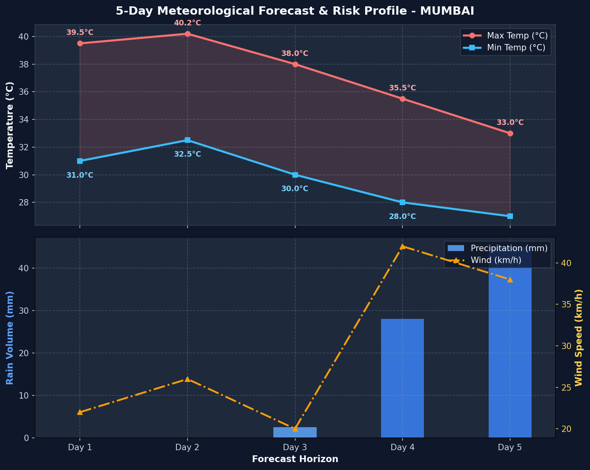

# 🌦️ Weather Forecast & Risk Alert Application

[](https://www.python.org/)
[](https://fastapi.tiangolo.com/)
[](https://streamlit.io/)
[](https://pytest.org/)
[]()
[](LICENSE)

An enterprise-ready, modular meteorological monitoring and hazard alerting platform. Designed for **Logistics, Agriculture, Public Municipalities, and Event Planning**, this application ingests real-time observations and 5-day predictive forecasts, executes an automated multi-hazard rule engine, exposes high-throughput REST APIs via **FastAPI**, and delivers rich interactive analytics via a **Streamlit** dashboard.

> **Zero-Dependency Virtual Simulation Engine Included**: Runs immediately out of the box with realistic weather scenarios and sample benchmarks—no paid subscriptions or active API keys required for testing and demonstration!

---

## 📌 Project Overview & Problem Statement

### The Problem
Adverse meteorological events—sudden flash floods, torrential downpours, scorching heatwaves, freezing black ice, and hurricane-force gale winds—cause billions of dollars in supply chain disruptions, lost agricultural yields, flight diversions, and public safety hazards annually. Most raw weather apps only display static numbers (e.g. *"34°C, 80% humidity"*) without context or operational guidance.

### The Solution
This application bridges raw telemetry and actionable intelligence:
1. **Automated Risk Rule Engine**: Dynamically evaluates ambient atmospheric metrics against customizable hazard thresholds (heatwaves, sub-zero freeze, excessive rainfall, gale-force winds, high humidity discomfort, and elevated AQI PM2.5).
2. **Actionable Recommendations**: Produces industry-specific countermeasures for freight haulers, farm irrigators, civil defense authorities, and everyday commuters.
3. **Multi-Channel Distribution**:
   - **REST API** (`FastAPI`): Programmatic integration into third-party ERP, dispatch, or IoT systems.
   - **Interactive Web Dashboard** (`Streamlit`): Visual exploration with real-time sliders, geospatial maps, and Plotly charts.
   - **Automated Audit Exports**: Downloadable compliance reports in **CSV** and **JSON** with cryptographic timestamps.

---

## 🏭 Industry Relevance

| Sector | Operational Use Case | Mitigated Risk |
|---|---|---|
| **Logistics & Supply Chain** | Gale-wind warning and torrential rain alerts route fleets away from hazardous highways and flooded underpasses. | Cargo spoilage, vehicle hydroplaning, delayed deliveries. |
| **Agriculture & Farming** | Frost/freeze alerts and heat index monitoring trigger automated sprinkler anti-frosting or greenhouse shade curtains. | Crop frostbite, livestock heat exhaustion, irrigation waste. |
| **Aviation & Maritime** | High crosswind detection, barometric drops, and visibility monitoring inform runway assignments and vessel docking. | Turbulence incidents, port crane collisions, demurrage costs. |
| **Event Management** | Automated rain and thunderstorm tracking triggers contingency venue shifts or tent anchoring. | Equipment water damage, attendee safety liabilities. |

---

## 🚀 Key Features

- **Dual Ingestion Architecture**:
  - Live API integration with **OpenWeatherMap** and **WeatherAPI**.
  - Built-in **Virtual Atmospheric Simulator** that generates realistic, reproducible synthetic datasets with zero API keys required.
- **Multi-Factor Hazard Engine**:
  - **Heatwave Alert**: Calculates human bioclimatological Heat Index using the Rothfusz regression model.
  - **Cold Wave / Freeze Alert**: Flags sub-zero conditions and black ice hazard.
  - **Precipitation Hazard**: Detects moderate showers and torrential flash flood conditions.
  - **Gale Wind Advisory**: Analyzes sustained winds and gust velocities.
  - **Air Quality Warning**: Evaluates fine particulate matter (PM2.5) concentrations.
- **RESTful API Service**:
  - Built with **FastAPI** and **Pydantic v2**.
  - Interactive OpenAPI Swagger documentation available at `/docs`.
  - CORS enabled for React / Next.js frontends.
- **Interactive Streamlit Dashboard**:
  - Live KPI metric tiles with Delta indicators.
  - Dual-axis interactive **Plotly** charts (Thermal Range vs. Precipitation/Wind).
  - Geographic city map projection (`st.map`).
  - Interactive threshold tuning sliders in the control sidebar.
- **Automated Data Processing & Reporting**:
  - Converts payloads into normalized **Pandas** DataFrames.
  - One-click CSV and JSON compliance report downloads.
  - Static publication-quality **Matplotlib** infographics saved in `outputs/charts/`.
- **Comprehensive Pytest Suite**: 8 automated unit tests verifying alert logic, simulator edge cases, and report persistence.

---

## 🛠️ Tech Stack

- **Language**: Python 3.10+ (Tested on Python 3.13)
- **REST Backend**: FastAPI, Uvicorn, Pydantic v2, Starlette
- **Interactive UI**: Streamlit, Plotly Express & Graph Objects
- **Data Engineering**: Pandas, NumPy
- **Visualization**: Matplotlib, Seaborn
- **HTTP Client**: Requests, HTTPX
- **Environment Management**: Python-dotenv
- **Testing & Quality**: Pytest

---

## 📂 GitHub Repository Folder Structure

```
Weather-Forecast-Alert-Application/
│
├── data/
│   └── sample_weather.json         # Offline benchmark datasets (Mumbai, London, Tokyo, etc.)
│
├── src/
│   ├── __init__.py                 # Package initializer
│   ├── api_client.py               # Resilient API client with auto-simulator fallback
│   ├── alert_engine.py             # Multi-factor hazard evaluation rule engine
│   ├── data_processor.py           # Pandas normalization and 5-day statistical aggregations
│   ├── simulator.py                # Synthetic weather generator and anomaly scenarios
│   ├── visualizer.py               # Matplotlib static infographics and Plotly dashboard charts
│   └── report_generator.py         # CSV and JSON audit report export engine
│
├── outputs/
│   └── charts/                     # Generated high-resolution static PNG charts
│
├── images/                         # Visual assets for GitHub README documentation
│   └── mumbai_forecast_chart.png
│
├── reports/                        # Timestamped CSV/JSON operational reports
│
├── docs/
│   ├── architecture.md             # Detailed architectural diagrams & data flow
│   └── api_docs.md                 # Complete REST API route specifications
│
├── tests/
│   └── test_alerts.py              # Automated unit tests for risk rules & data models
│
├── app.py                          # FastAPI REST API backend service
├── dashboard.py                    # Streamlit interactive web dashboard
├── main.py                         # CLI orchestrator and runner
├── requirements.txt                # Production Python dependencies
├── .env.example                    # Safe environment variable configuration template
├── .gitignore                      # Git exclusion rules preventing credential leaks
└── README.md                       # Master project documentation
```

---

## ⚙️ Installation & Setup Guide

### 1. Clone the Repository
```bash
git clone https://github.com/your-username/Weather-Forecast-Alert-Application.git
cd Weather-Forecast-Alert-Application
```

### 2. Create and Activate Virtual Environment
**On Windows (PowerShell):**
```powershell
python -m venv venv
.\venv\Scripts\Activate.ps1
```

**On macOS / Linux:**
```bash
python3 -m venv venv
source venv/bin/activate
```

### 3. Install Dependencies
```bash
pip install -r requirements.txt
```

### 4. Configure Environment Variables (Optional)
The project works out of the box in simulation mode. If you have an OpenWeatherMap API key:
```bash
# Copy template
cp .env.example .env
```
Open `.env` and add your key:
```ini
OPENWEATHER_API_KEY=your_actual_key_here
```
*(Remember: `.env` is listed in `.gitignore` and is never pushed to GitHub).*

---

## 🚀 How to Run the Project

### Option 1: Run Interactive Streamlit Dashboard
```bash
python -m streamlit run dashboard.py
# Or via orchestrator:
python main.py --dashboard
```
Open your browser at `http://localhost:8501`.

### Option 2: Run FastAPI REST API Server
```bash
python -m uvicorn app:app --reload --port 8000
# Or via orchestrator:
python main.py --serve
```
Access interactive Swagger API Docs at `http://127.0.0.1:8000/docs`.

### Option 3: Run Command Line Interface (CLI Mode)
```bash
# Run weather check for default city
python main.py --city "Mumbai"

# Run offline virtual simulation for any city
python main.py --city "London" --simulate

# Run specific meteorological crisis scenario
python main.py --simulate --scenario heatwave
python main.py --simulate --scenario monsoon
python main.py --simulate --scenario gale
python main.py --simulate --scenario freeze
```

### Option 4: Run Automated Tests
```bash
python -m pytest tests/ -v
```

---

## 📊 Sample Outputs & Visualizations

### 1. Terminal Output Preview
```
================================================================================
     [WEATHER] FORECAST & RISK ALERT APPLICATION (CLI & ORCHESTRATOR)
================================================================================
[*] Ingesting meteorological telemetry for: 'Mumbai'...

[+] CURRENT METEOROLOGICAL OBSERVATION:
    Temperature:       39.4 C (Feels like: 46.2 C)
    Atmospheric State: Haze / Extreme Heat
    Relative Humidity: 88% | Pressure: 1008 hPa
    Wind Speed:        24.5 km/h (Gusts: 34.0 km/h)
    Air Quality (AQI): 142.0 ug/m3 PM2.5
--------------------------------------------------------------------------------
[+] RISK EVALUATION & HAZARD ALERTS:
    [!] [CRITICAL] : Extreme Severe Heatwave in Mumbai
        Trigger:       temperature_c = 39.4 (Threshold: 42.0)
        Details:       Recorded temperature 39.4°C (Heat Index: 46.2°C). High danger of heatstroke.
        Sectors:       Citizens, Logistics, Power Grid, Construction
        Action Advice: Suspend outdoor manual labor between 11 AM - 4 PM.
--------------------------------------------------------------------------------
[+] ARTIFACTS GENERATED:
    [*] Static Plot:  outputs/charts/mumbai_forecast_chart.png
    [*] CSV Report:   reports/report_mumbai_20261119_170749.csv
    [*] JSON Audit:   reports/report_mumbai_20261119_170749.json
```

### 2. Static Visualization Infographic
*(Auto-generated into `outputs/charts/mumbai_forecast_chart.png`)*


---

## 🧪 Testing & Validation

All modules are strictly validated using `pytest`:
- `test_heatwave_alert`: Validates heat index computation and severe temperature trigger.
- `test_torrential_rain_alert`: Asserts flood hazard severity when rain exceeds thresholds.
- `test_freezing_cold_alert`: Confirms black ice and sub-zero freeze alerts.
- `test_gale_wind_alert`: Verifies aerodynamic threshold flags.
- `test_normal_stable_weather`: Asserts baseline NORMAL notices for benign conditions.
- `test_simulator_scenarios`: Tests all 6 virtual meteorological anomaly simulations.
- `test_data_processor_dataframe`: Verifies DataFrame parsing and range derivations.
- `test_report_generation`: Validates disk persistence for CSV and JSON audits.

---

## 🎓 Learning Outcomes & Proof of Work
By constructing this end-to-end system, key engineering capabilities demonstrated include:
1. **API Integration & Resilience**: Designing fallback strategies to prevent single-point-of-failure outages.
2. **Domain Rule Engine Design**: Implementing multi-factor bioclimatological models (Heat Index, wind gale, flood metrics).
3. **Enterprise REST Architecture**: Building type-safe, asynchronous microservice endpoints with FastAPI and Pydantic.
4. **Interactive Data Visualization**: Creating production dashboards in Streamlit with dynamic Plotly charts.
5. **Secure Configuration Management**: Strict separation of secrets using environment variables and `.gitignore`.
6. **Automated Testing & CI/CD Readiness**: Developing unit tests ensuring zero regressions.

---

## 👤 Author & Contribution
Developed as an applied industry-oriented project for Python Development, Data Engineering, and API Specialization.

- **GitHub**: [@your-username](https://github.com/your-username)
- **LinkedIn**: [Your LinkedIn Profile](https://linkedin.com/)
